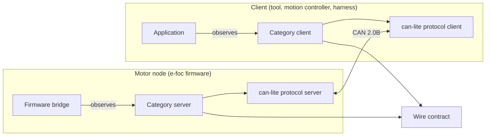
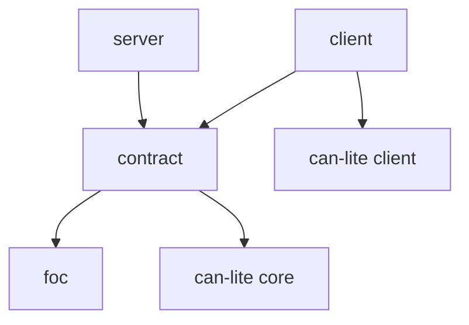

| Field     | Value               |
|-----------|---------------------|
| Title     | System Architecture |
| Type      | architecture        |
| Status    | draft               |
| Version   | 0.2.0               |
| Component | system              |
| Date      | 2026-11-11          |

> Diagrams must be Mermaid or ASCII art; external image references are not allowed.

---

## Assumptions & Constraints

- **Constraint**: no dynamic memory allocation anywhere outside tests; the library runs on the motor node's
  microcontroller as well as on hosts.
- **Constraint**: the library knows nothing of what a node does with a command; it decodes and encodes.
- **Constraint**: one definition of the contract, shared by the node and every client.
- **Assumption**: the consumer provides embedded-infra-lib, can-lite and numerical-toolbox when it adds this
  library to its own build; a standalone build takes them from submodules.

---

## System Overview

e-foc-protocol is the FOC motor category (`0x02`) of can-lite. A motor node registers the server category
beside its can-lite protocol server and attaches one observer that drives the motor. A client — a host tool,
a motion controller commanding several joints, or a SIL harness — owns a client object per bus and addresses
each node by its node ID.

---

## Component Decomposition

| Component | Responsibility                                                                    |
|-----------|-----------------------------------------------------------------------------------|
| foc       | Units, accepted parameter ranges and their checks                                 |
| contract  | Message catalogue, payload descriptors, parameter table, contract version         |
| server    | Decodes commands into observer callbacks; encodes answers and telemetry           |
| client    | Encodes commands; decodes answers and telemetry; tracks each node's contract      |

---

## Interfaces & Contracts

### Provided Interfaces

| Interface                      | Direction | Purpose                                     | Invariants                                  |
|--------------------------------|-----------|---------------------------------------------|---------------------------------------------|
| FocMotorCategoryServer         | provided  | The node's side of the category             | Length-exact decode; one observer           |
| FocMotorCategoryServerObserver | provided  | What the node does with each command        | Callbacks do not block or allocate          |
| FocMotorCanClient              | provided  | The client's side of the category on a bus  | Refuses commands to an incompatible node    |
| FocMotorCategoryClientObserver | provided  | Answers and telemetry, named by source node | Callbacks do not block or allocate          |

### Required Interfaces

| Interface         | Direction | Purpose                     | Invariants                                  |
|-------------------|-----------|-----------------------------|---------------------------------------------|
| hal::Can          | required  | Raw CAN bus access          | Provided by the platform                    |
| CanFrameTransport | required  | Framing, sequence and ACKs  | Provided by can-lite                        |

---

## Open Questions & Decisions

| # | Question / Decision                                        | Status   | Options Considered                        | Rationale                                                          |
|---|------------------------------------------------------------|----------|-------------------------------------------|--------------------------------------------------------------------|
| 1 | Where the contract lives                                   | decided  | e-foc `core/can`, can-lite, own library   | Shared by firmware and clients without pulling in the firmware     |
| 2 | Board-kind registry                                        | decided  | In the contract, in the firmware          | The contract carries a byte; which kinds exist is the firmware's   |
